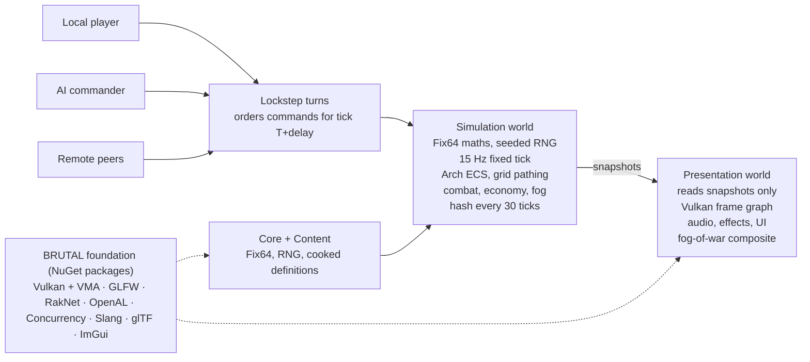

# Project Ashfall — Game Design Document

Oct 17, 2026

## 1. Vision and pillars

**Ashfall is a fast, readable, base-building RTS in the Tiberian Sun: Firestorm tradition — isometric battlefields, a hazardous spreading resource, three sharply asymmetric factions — rebuilt on a modern deterministic engine with procedural maps and lobby-based team multiplayer.** "Project Ashfall" is a working codename.

**Premise (placeholder).** Decades ago a meteor shower seeded Earth with *Cindrite*, a crystalline mineral that spreads across the land, poisons what it touches and is the most valuable energy source ever found. Three powers fight over the fields.

**Design pillars**

1. **Readable chaos.** Every unit's role, team and state is legible at a glance from a fixed isometric camera. Silhouette and team colour beat detail.
2. **Asymmetry with parity.** Factions play differently in economy, mobility and tech, not just in stats, yet win rates stay within ±3% at every skill tier.
3. **Every match is a new map.** Rule-driven generation produces maps that are fair, scoutable and worth replaying; hand-made maps remain supported.
4. **Fair, robust multiplayer.** Deterministic lockstep, desync detection, replays and reconnect from day one, not bolted on.
5. **Data-driven and moddable.** Units, weapons, factions and map rule-sets live in content files, not code.

**Audience.** Players who loved 1997–2003 Command & Conquer–era RTS and want that feel without its age; secondary audience of competitive team players and modders.

**Scope for v1.0**

| In scope | Out of scope (post-1.0) |
| --- | --- |
| Skirmish vs AI, online and LAN multiplayer, 1–8 players, up to 4 teams | Story campaign |
| 3 factions, ~12–15 units and ~15–18 structures each | Ranked ladder and seasons |
| Procedural maps + hand-authored map loading | Map editor GUI (a preview tool ships instead) |
| AI at four difficulties, several personalities | macOS, consoles |
| Replays, observers, desync reports | In-sim scripting for mods |

**Platforms.** Windows and Linux, because BRUTAL targets those two today and requires a Vulkan 1.3 GPU.

## 2. Core gameplay loop and economy

**The loop is classic: deploy, harvest, build, tech, fight — with Cindrite's spread and power management as the two pressures that force players out of their base.** A 1v1 should last 15–30 minutes; 4v4 up to 45.

**Moment to moment:** scout → secure a Cindrite field → expand production → trade armies at chokepoints → raid harvesters and power → tech into a decisive push.

**Resources**

| Resource | Source | Spent on | Pressure it creates |
| --- | --- | --- | --- |
| Credits | Harvesters carry Cindrite to a Refinery | Units, structures, upgrades | Fields deplete and regrow slowly, so players must expand |
| Power | Power plants (faction-specific) | Passive drain per structure | Low power slows production by 50% and shuts off powered defences and radar |
| Cindrite (field) | Spreads from *Blossom* nodes each few minutes | Harvested, never spent directly | Damages infantry standing in it; fields creep toward bases over time |

**Match flow**

1. **Opening (0–3 min).** Deploy the Mobile Construction Vehicle (MCV), build power, refinery, barracks. Starting credits default to 5,000 (lobby option).
2. **Expansion (3–10 min).** Second refinery or a forward construction yard on a new field. Light raids on harvesters.
3. **Mid game (10–20 min).** Tier 2 tech, combined arms, map control via chokepoints and tech buildings.
4. **Late game (20+ min).** Tier 3 units, superweapons (lobby toggle), base-busting pushes.

**Supporting systems**

- **Veterancy:** three ranks (Veteran, Elite, Heroic) from kills; +damage, +armour, self-heal at Elite.
- **Fog of war and shroud:** black shroud until explored, grey fog outside current vision. Shroud can be toggled off in the lobby.
- **Repair and sell:** structures repair for credits, sell for 50% refund.
- **Neutral tech buildings:** capturable by engineers for perks (extra radar, a repair depot, a credit trickle).
- **Crates (optional):** random pickups, off by default in multiplayer.

**Victory conditions** (lobby option): destroy all structures (default), annihilation (all units and structures), or hold-the-relay (control a central uplink for N minutes).

## 3. Factions

**Three factions differ in how they earn, move and win, not only in unit stats: the Bulwark entrenches, the Kindred infiltrates, the Lattice adapts.** Each faction must have at least one mechanic the others cannot copy.

| | Bulwark Directorate | The Kindred | The Lattice |
| --- | --- | --- | --- |
| Identity | Remnant global military; order through force | Cindrite-worshipping insurgency, mutated by the crystal | Rogue machine intelligence born in an abandoned mining grid |
| Playstyle | Turtle and push; combined arms; strong late game | Hit and run, stealth, swarm; strong early game | Slow start, snowballing; flexible mid game |
| Economy twist | Armoured harvesters; refineries can be upgraded for +25% yield | Infantry immune to Cindrite; can *seed* new Blossoms | Converts wrecks and Cindrite into energy; no power plants, structures draw from harvest |
| Mobility trick | Jump-jet infantry, deployable bridges | Subterranean APCs tunnel under walls | Units reassemble at the nearest Node when destroyed (with cooldown) |
| Defences | Best walls, gates and artillery emplacements | Cheap, hidden (cloaked) defences | Mobile turrets that deploy and pack up |
| Strengths | Durability, artillery range, shield generators | Speed, stealth, cheap mass infantry | Self-repair, unit upgrades mid-match, adaptability |
| Weaknesses | Slow, expensive, weak early | Fragile, poor anti-armour late | Weak early, starved if harvesters die |
| Signature unit | *Titan* walker: heavy cannon, crushes infantry | *Devourer*: tunnelling worm that surfaces under bases | *Hive Core*: mobile factory that builds drones in the field |
| Superweapon | Orbital lance (precise, line damage) | Cindrite storm (area denial, spreads crystal) | System override (mind-controls units in an area for 30 s) |

**Faction design rules**

- Every faction has a counter for every unit class (infantry, light vehicle, heavy vehicle, air, structure).
- No faction has a strictly better version of another faction's unit at the same cost.
- Each faction gets 1–2 lobby-visible "sub-doctrines" post-1.0 (e.g. Bulwark Air Command) for variety, in the spirit of Firestorm-era additions.
- Balance targets are tracked by headless AI-vs-AI tournaments (section 7) plus human playtest telemetry.

## 4. Units, buildings, tech and combat

**Combat uses a warhead-versus-armour matrix, so counters are explicit data, and tech is gated in three tiers by prerequisite structures.** All numbers below are starting values for tuning.

**Damage matrix (percent of base damage dealt)**

| Warhead / Armour | None (infantry) | Light | Heavy | Structure | Air |
| --- | --- | --- | --- | --- | --- |
| Small arms | 100 | 50 | 10 | 10 | 40 |
| Anti-armour | 25 | 100 | 100 | 60 | 0 |
| High explosive | 120 | 75 | 50 | 100 | 0 |
| Flame / chemical | 150 | 60 | 20 | 50 | 0 |
| Anti-air flak | 30 | 20 | 10 | 0 | 120 |
| Energy (Lattice) | 70 | 90 | 90 | 80 | 60 |

**Tech tiers**

| Tier | Unlocked by | Typical contents |
| --- | --- | --- |
| T1 | Construction Yard + Barracks / Factory | Rifle infantry, rocket infantry, engineer, scout vehicle, harvester, light tank, basic defences |
| T2 | Radar / Command Uplink | APCs, artillery, medium tanks, aircraft, stealth, upgrades |
| T3 | Tech Centre (one per faction, expensive) | Signature units, heavy aircraft, superweapon structure |

**Roster template per faction** (~13 units, ~16 structures)

- **Infantry (4–5):** basic rifle, anti-armour, engineer (capture/repair), specialist (sniper, jump-jet, mutant), commando-style hero (1 per player).
- **Vehicles (5–6):** harvester, MCV, scout, main battle tank, artillery, signature heavy.
- **Air (2):** attack craft, transport or bomber; aircraft rearm at pads.
- **Structures:** Construction Yard, power (except Lattice), Refinery, Barracks, Factory, Airfield, Radar, Repair Bay, Tech Centre, walls/gates, 3–4 defences, superweapon.

**Unit rules**

- **Locomotors:** foot, wheel, track, hover, amphibious, subterranean, air. Each defines terrain speed modifiers and which cells it can enter.
- **Crush:** tracked vehicles crush infantry; heavy walkers crush light vehicles.
- **Height advantage:** firing from a higher terrain level grants +25% range; firing uphill at an unseen target is impossible.
- **Cell occupancy:** up to 5 infantry share a cell at sub-positions; one vehicle per cell.
- **Commands:** move, attack, attack-move, force-fire, guard, patrol, waypoint queues, deploy, stop, scatter, plus control groups 0–9 and camera bookmarks.

## 5. Camera, presentation and UI

**Units and structures are 3D and voxel models pre-rendered offline into sprite atlases that carry normals and depth, so the game keeps the crisp sprite look of Tiberian Sun while getting real-time dynamic lighting.** Terrain is a runtime mesh on a tile grid with discrete height levels, lit by the same lights.

**Camera**

- Orthographic projection, yaw 45°, pitch ~30° (2:1 dimetric so tile edges land on clean pixel steps).
- Pans by edge-scroll, keyboard, middle-drag and minimap; 3 fixed zoom steps. No rotation in v1 (it breaks readability and the classic feel).

**Terrain**

- Logical grid of square cells (e.g. 128×128 to 256×256), each with a height level 0–7, a terrain type and a ramp shape.
- Rendered as a mesh generated from the grid, with tile-transition blending (shore, cliff, road, Cindrite) chosen by rule tiles.
- Cliffs block ground movement and line of sight; ramps connect levels.

**Art pipeline: pre-rendered sprites**

- **Sources:** vehicles, aircraft and infantry as 3D models (glTF, e.g. from Blender); **buildings as voxel models** (MagicaVoxel `.vox`), a nod to Tiberian Sun's voxel vehicles.
- **Offline cooker** (`Ashfall.Tools.ContentCooker`) renders every model through the exact game camera (orthographic, yaw 45°, 2:1 dimetric) into atlas frames. Each frame stores five channels: albedo, normal, depth (height above the ground plane), team-colour mask, emissive.
- **Facings:** vehicles and aircraft 32 directions with turrets as a separate layer; infantry 8 directions; structures 1 facing plus build-up, damaged, destroyed and animated states (doors, radar dishes, smokestacks).
- **Animation:** baked frame sequences per state (idle, move, fire, die, deploy), stored as KTX2 atlases.
- **Why pre-render:** consistent pixel look, cheap to draw thousands of units, and a solo artist can iterate in Blender/MagicaVoxel and re-cook in one command. The cost is texture memory and re-cooking when the camera angle changes, so the angle is locked in M0.

**Lighting and effects**

- **Dynamic lighting on sprites:** sprites are drawn into a G-buffer (albedo, normal, depth, emissive); a deferred lighting pass applies one directional sun plus hundreds of point lights (muzzle flashes, explosions, Cindrite glow, base lights). Sprite depth gives correct occlusion against terrain and each other.
- **Shadows:** the sun's shadows come from sprite depth projected onto terrain (or baked shadow sprites per facing as a fallback).
- Day/night and ion-storm style weather as lobby options post-1.0.
- Fog of war and shroud rendered as a screen-space mask sampled from a per-player visibility texture.

**UI**

- Classic right-hand sidebar: build tabs (structures, defences, infantry, vehicles, aircraft), credits, power bar, minimap/radar. Option for a bottom-bar layout later.
- Game UI is a custom retained-mode renderer on the Vulkan backend; Dear ImGui (bundled with BRUTAL) is for debug and tooling only.
- Announcer voice for key events (unit ready, base under attack, low power).

## 6. Procedural map generation

**Maps are built in two halves: a gameplay layout graph decides where bases, expansions and chokepoints go, then terrain is grown to fit it; every map is scored for fairness and regenerated until it passes.** Generating terrain first and hoping it plays well is the main cause of bad procedural RTS maps.

**Inputs (the map spec, set in the lobby):** seed, archetype (rule-set), player count, team layout, biome, and the map sliders below.

**In-game map sliders.** The lobby shows a set of sliders that drive the selected archetype's rule-set. Each archetype declares, per slider, the parameter range it maps to and its default, so the same slider means "more water" in Riverlands and "more shallow fords" in Archipelago. Slider values (0–100) are part of the map spec, so every peer generates the same map, and the minimap preview regenerates live on a worker thread as sliders move.

| Slider | Drives (rule-set parameters) | Low → High |
| --- | --- | --- |
| Map size | Grid dimensions, lane length | 96×96 → 256×256 cells |
| Resource richness | Fields per node, Blossoms, field value | Sparse → Abundant |
| Cindrite spread | Blossom growth rate, max field radius, hazard zones | Static → Aggressive |
| Elevation | Height levels used, cliff frequency, ramp count | Flat → Mountainous |
| Water | Rivers, lakes, fords, bridges | Dry → Flooded |
| Chokepoints | Lane width and number of lanes between starts | Open → Tight |
| Base spacing | Minimum path distance between start positions | Close → Far |
| Vegetation and clutter | Forest and doodad density (never on lanes) | Bare → Dense |
| Neutral structures | Capturable tech buildings, civilian ruins | None → Many |
| Symmetry (dropdown) | Layout-graph transform | Mirror · Rotational · Loose |

- **Randomise** rolls seed and sliders within the archetype's allowed ranges; **Reset** restores archetype defaults.
- **Map code:** seed, archetype and slider values pack into a short shareable string (e.g. `RIV-7F3A-…`) to replay a favourite map.
- **Conflicting settings** (e.g. Flooded + Tight + Close) are clamped by archetype rules; the lobby shows which slider was limited instead of silently failing.

**Pipeline stages**

1. **Layout graph.** Place start nodes, expansion nodes, contested centre and tech-building nodes on an abstract graph. Edges are lanes with a width (narrow choke, normal, open). Symmetry is enforced here: mirror for 2 teams, rotational for 3–8 starts.
2. **Embed.** Map nodes onto the grid using the symmetry transform; reserve a flat buildable plateau around each start.
3. **Heightfield.** Layered noise (domain-warped fBm) quantised to discrete height levels, then masked so lanes and plateaus override noise.
4. **Carve and connect.** Cut lanes, place ramps at level changes, rivers and lakes from the archetype, bridges where lanes cross water. Guarantee ground connectivity between every pair of starts.
5. **Resources.** Cindrite fields and Blossoms per node type, scaled by richness, with equal value per start within ±5%.
6. **Dress.** Rule tiles / wave-function-collapse pass for tile transitions, then cliffs, trees, rocks, civilian ruins and neutral structures placed by density rules that never block lanes.
7. **Validate and score.** Hard checks (connectivity, buildable area per start ≥ threshold, no resource inside another base). Fairness score from start-to-resource distance, start-to-enemy path length, chokepoints per side and exposure. Fail → reseed the sub-stage, max N retries, then fall back to a known-good seed.

**Rule-sets (archetypes)** are data files. Starting set for v1:

| Archetype | Character | Key rules |
| --- | --- | --- |
| Crossroads | Open central plain, 4 lanes | Wide lanes, rich centre field, few cliffs |
| Canyonlands | Choke-heavy, high ground matters | Narrow lanes, 4–6 height levels, ramps contested |
| Riverlands | Bridges as objectives | 1–3 rivers, destructible bridges, amphibious shortcuts |
| Archipelago | Air and naval-lite | Islands joined by shallow fords, small bases |
| Infestation | Cindrite-dominated | Fast Blossom spread, hazard zones, scarce safe ground |

**Determinism and transport.** The generator is pure and uses the simulation's fixed-point maths and seeded RNG. Peers receive only *(seed, rule-set id, rule-set content hash, generator version)*, generate locally and compare a map hash before the match starts. A mismatch falls back to the host streaming the compressed map.

**Tooling.** A standalone map preview tool renders thousands of seeds per archetype with their fairness scores, so designers tune rule-sets on statistics, not single samples.

## 7. AI opponents

**The AI is a player like any other: it reads a fog-limited view of the game and issues the same commands a human does, through the same lockstep pipeline.** Difficulty comes from skill limits, not cheating, until the top tier.

**Architecture (three layers)**

1. **Strategic (every ~2 s).** Commander picks goals with utility scoring: expand, tech, defend, attack, harass. Follows data-driven build orders per faction and personality, then switches to reactive production.
2. **Operational (every ~0.5 s).** Squad manager forms armies, chooses targets from influence maps (threat, value, resources), times attacks, assigns defenders and harvester escorts.
3. **Tactical (every tick budgeted).** Unit micro: focus fire, retreat damaged units, kite, pull harvesters, use abilities.

**Where it runs.** AI runs on the host (or on any peer chosen at start), emits commands into the lockstep stream, and so does not need to be bit-deterministic itself. If the host leaves, AI ownership migrates with a state rebuild from the sim. The same AI runs headless for testing.

**Difficulty tiers**

| Tier | Reaction delay | Commands/min cap | Macro | Micro | Scouting | Advantages |
| --- | --- | --- | --- | --- | --- | --- |
| Easy | 1.5 s | 30 | One refinery, slow build order, attacks late | None | Minimal | None |
| Medium | 0.8 s | 60 | Expands once, sensible counters | Retreats badly damaged units | Periodic | None |
| Hard | 0.3 s | 120 | Efficient build orders, multi-pronged attacks | Focus fire, harvester harass | Active | None |
| Brutal | 0.15 s | 250 | Optimised | Full | Constant | Optional +25% income lobby toggle |

**Personalities** (combine with any tier): Turtle, Rusher, Balanced, Technologist, Raider. Each is a data file of weights and build orders, so modders can add more.

**Team play.** Allied AIs share a team blackboard: coordinated attacks, responding to ally pings, and honouring simple human requests ("attack here", "defend me") issued via the ping wheel.

**Quality loop.** Nightly headless AI-vs-AI tournaments on generated maps produce win-rate tables per faction, personality and archetype; they double as balance and determinism regression tests.

## 8. Multiplayer, lobby and teams

**Use peer-to-peer deterministic lockstep: every peer sends its commands directly to every other peer, all peers run the identical fixed-point simulation, and periodic state hashes catch desyncs.** There are no online services at all: players forward a port and join by IP or invite code. Players are identified by anonymous IDs.

**Netcode model**

- **Simulation tick:** 15 Hz fixed (66.7 ms). Rendering interpolates between the last two sim states at display rate.
- **Command turns:** each peer sends its commands for tick *T + delay* to all peers (an empty turn if idle); a tick runs only when every peer's turn has arrived. Delay adapts to the slowest round-trip in the mesh (2–6 ticks, i.e. 133–400 ms).
- **Topology:** full mesh — 8 players means up to 28 peer links, at a few hundred bytes per second each, well within home bandwidth. The lobby host only coordinates lobby state and start; it has no authority in-game.
- **Players without a forwarded port:** they connect out to peers who do have one, and those peers forward turns for any pair with no direct link. Only the host strictly needs a forwarded port; each extra forwarded port removes a hop.
- **Transport:** RakNet via `Brutal.RakNet` (reliable-ordered UDP on one configurable port; the game also tries UPnP/NAT-PMP to open it automatically), behind an `ITransport` interface so LAN, loopback, an in-memory test transport and a lossy/latent simulated transport plug in the same way.
- **Identity:** a random anonymous ID (Ed25519 key pair) generated on first launch and stored locally; display names are free text. Turns are signed so a peer cannot forge another's commands.
- **Desync detection:** every 30 ticks each peer broadcasts a hash of sim state; on mismatch the game pauses, and every peer writes a desync dump (state diff + command log).
- **Replays:** the command log plus match settings and content hash. Seekable via periodic snapshots.
- **Reconnect and late observers:** a chosen peer streams its latest snapshot plus commands since; the joiner fast-forwards headless at maximum game speed.
- **Pause, speed and timeouts:** limited pauses per player; a lagging player triggers a wait dialog, then drop-to-AI after a vote.

**Lobby**

| Area | Features |
| --- | --- |
| Discovery | Direct IP:port, invite codes (host address, port and lobby password in one string), LAN broadcast, recent and favourite hosts |
| Slots | Up to 8: Open, Closed, Human, AI (tier + personality), plus up to 4 observers |
| Per player | Name, faction (or random), colour, team, start position (or random) |
| Map | Procedural (archetype, seed, biome and the map sliders from section 6) or file; live minimap preview generated locally; shareable map code |
| Rules | Starting credits, tech level, superweapons, crates, shroud, victory condition, game speed |
| Flow | Ready check → map hash + content hash agreement → countdown → load → sync start |
| Social | Chat, kick/ban by host, host migration while in lobby |

**Teams**

- 2–4 teams (FFA allowed), teams lockable by host; shared vision and radar, allied structures block but do not attack.
- Credit transfer and shared unit control are lobby options (off by default).
- Team victory when all opponents are defeated; defeated players can become observers.
- Ping wheel and map markers visible to the team only.

**Connecting (no online services).** The host forwards one UDP port; others join by IP:port or invite code, or find LAN games by broadcast. On join, every peer tests every other peer's port and the lobby shows a reachability icon per player, so a closed port is caught before the match rather than as a mid-game drop. Nothing depends on infrastructure the project hosts, so multiplayer keeps working indefinitely. A discovery or NAT service could be added later without touching the netcode, because it would only change how peers find each other.

## 9. Technical architecture on BRUTAL

**BRUTAL gives us the foundation — Vulkan, windowing, maths, memory, jobs, networking and audio bindings — but deliberately no renderer, scene graph or ECS, so the engine layer is ours to build.** The central design decision is a hard split between a deterministic *Simulation* world and a non-deterministic *Presentation* world.



All three command sources feed the same lockstep queue; the presentation world reads simulation snapshots and never writes back.

**What we take from BRUTAL**

| Need | BRUTAL package | Notes |
| --- | --- | --- |
| Window, input | `Brutal.Glfw` | Matches BRUTAL's own quick start; SDL is an alternative if gamepad/IME needs grow |
| Graphics | `Brutal.Vulkan`, `.Abstractions`, `.Vma` | Vulkan 1.3 + Vulkan Memory Allocator |
| Shaders | `Brutal.Slang` (build time), `Brutal.ShaderC` (hot reload) | Slang source compiled to SPIR-V |
| Runtime assets | `Brutal.Ktx`, `Brutal.Texture` | KTX2 sprite atlases (5 channels per frame) |
| Offline cooking | `Brutal.Gltf`, `Brutal.MeshOptimizer`, `Brutal.Vulkan` (headless) | Cooker renders glTF and voxel models to atlases with the game's own Vulkan code |
| Core | `Brutal.Core`, `.Memory`, `.Collections`, `.Strings`, `.Maths`, `.Numerics` | Allocation-free building blocks |
| Threads | `Brutal.Concurrency` | Job system for render extraction and parallel sim systems |
| Network | `Brutal.RakNet` | Reliable UDP transport; lockstep protocol is ours |
| Audio | `Brutal.OpenAl` (OpenAL Soft) | Free: no licence fee or revenue cap, unlike FMOD. 3D positional sound, music streaming; `Brutal.Sdl.Mixer` is the fallback |
| Debug | `Brutal.ImGui`, `.ImPlot`, `Brutal.RenderDoc`, `Brutal.Monitor.*` | Dev overlays, profiling, GPU captures |

**Simulation world (deterministic)**

- Fixed 15 Hz tick, single authoritative order of system execution, driven only by the command stream.
- **No floating point.** Positions, speeds and damage use a 32.32 fixed-point type (`Fix64`) with table-based trig and sqrt; one seeded RNG per match (xorshift128+ or PCG).
- No `Dictionary`/`HashSet` iteration, no wall-clock time, no thread-order-dependent writes. Parallel systems only write to their own entity's components.
- Pathfinding on the cell grid: hierarchical A* (clusters) for long routes, flow fields for large group moves, local steering and cell reservation for collisions. BRUTAL's Jolt/Box2D are float-based, so they are used only for cosmetic debris, never in the sim.
- Snapshot and restore of the whole sim state for reconnect, replay seeking and desync dumps.

**ECS choice.** Use **Arch** (archetype/chunk ECS, NuGet `Arch` 2.1.0) for both worlds, behind thin wrappers. Arch is fast and widely used in C# engines. For the sim we add rules for determinism: stable entity IDs, structural changes buffered and applied in sorted order at end of tick, and sorted iteration where order affects outcomes. Milestone 0 includes a spike comparing Arch against a small in-house sparse-set ECS; if Arch cannot guarantee identical iteration order across peers, the sim moves to the in-house ECS and Arch stays for presentation.

**Presentation world (float, interpolated)**

- Each frame, an extraction step copies interpolated transforms and visual state from the last two sim ticks into render-side components. Sim never reads from presentation.
- Effects, particles, sounds, UI animation and camera live only here.

**Vulkan renderer**

- Vulkan 1.3 with dynamic rendering, synchronization2 and descriptor indexing (bindless atlases); frames-in-flight = 2.
- A small frame graph orders passes: terrain G-buffer → sprite G-buffer (instanced quads writing albedo, normal, depth, emissive, team colour) → shadow projection → deferred lighting (sun + clustered point lights) → decals (scorch, Cindrite) → transparent particles → fog-of-war composite → post (tonemap, optional pixel snap) → UI.
- Sprites are sorted by isometric depth on the GPU; per-frame depth from the atlas resolves overlaps exactly.
- Target: 60 fps at 1080p with 1,000 units on a mid-range Vulkan 1.3 GPU.

**Threading**

- Main thread: window, input, render submission.
- Sim thread: runs ticks as commands arrive; publishes double-buffered snapshots.
- Job workers (`Brutal.Concurrency`): render extraction, culling, AI planning, map generation, asset streaming.

## 10. Solution structure and conventions

**One repository, one `.slnx` solution, projects layered so the deterministic simulation depends on nothing that renders, plays sound or touches the network.** Dependency direction is enforced by project references and an architecture test.

```text
ashfall/
├─ global.json                  # pins .NET 10 SDK
├─ Ashfall.slnx
├─ Directory.Build.props        # net10.0, nullable, warnings-as-errors, analyzers, LangVersion latest
├─ Directory.Packages.props     # Central Package Management (Ahwoo.Brutal.*, Arch, test libs)
├─ .editorconfig                # naming + style rules, enforced in build
├─ src/
│  ├─ Ashfall.Core/             # Fix64, FixVec2, deterministic RNG, ids, hashing — no deps
│  ├─ Ashfall.Content/          # definitions, loaders, schema validation, content hash
│  ├─ Ashfall.Simulation/       # ECS components + systems, grid, pathfinding, combat, economy
│  ├─ Ashfall.MapGen/           # rule-sets, slider mapping, pipeline stages, fairness scoring
│  ├─ Ashfall.AI/               # strategic/operational/tactical layers; emits commands
│  ├─ Ashfall.Networking/       # P2P lockstep, turns, desync, replays; ITransport + RakNet impl
│  ├─ Ashfall.Session/          # match host: wires sim + AI + net + game-speed clock; no window/GPU
│  ├─ Ashfall.Rendering/        # Vulkan device, frame graph, sprite G-buffer, deferred lighting, fog
│  ├─ Ashfall.Audio/            # OpenAL Soft wrapper, announcer, music states
│  ├─ Ashfall.UI/               # sidebar, lobby screens, map sliders, HUD widgets
│  ├─ Ashfall.Client/           # exe — composition root: Session + Rendering + Audio + UI
│  └─ Ashfall.Headless/         # exe — Session only: e2e tests, AI tournaments, replay verify
├─ tools/
│  ├─ Ashfall.Tools.ContentCooker/   # glTF/.vox → sprite atlases (KTX2), defs → runtime packs
│  ├─ Ashfall.Tools.MapPreview/      # batch-render seeds + slider sweeps + scores (ImGui)
│  └─ Ashfall.Tools.ReplayInspector/ # step, diff and dump replays/desyncs
├─ tests/
│  ├─ Ashfall.Core.Tests/
│  ├─ Ashfall.Simulation.Tests/
│  ├─ Ashfall.MapGen.Tests/          # property tests: connectivity, fairness across slider ranges
│  ├─ Ashfall.E2E.Tests/             # headless full matches, multiplayer, lobby, reconnect
│  ├─ Ashfall.E2E.Scenarios/         # scenario files (YAML): setup, scripted commands, assertions
│  ├─ Ashfall.Determinism.Tests/     # same replay → same hash on Windows and Linux
│  ├─ Ashfall.Architecture.Tests/    # forbids Simulation → Rendering/Networking refs, floats in sim
│  └─ Ashfall.Benchmarks/            # BenchmarkDotNet: tick time, pathfinding, ECS queries
├─ content/                     # source definitions (YAML), models, voxels, audio
└─ docs/                        # this GDD, ADRs (architecture decision records)
```

**Allowed dependencies:** Core ← Content ← Simulation ← (MapGen, AI, Networking) ← Session ← (Client, Headless). Rendering, Audio and UI depend on Simulation's read-only snapshot types only, and only Client references them, so everything Headless runs is exactly what players run minus presentation.

**Code conventions**

- Standard .NET naming (PascalCase types/members, `_camelCase` private fields), file-scoped namespaces, one public type per file, namespace = folder path.
- Components are small blittable `struct`s (no references) so they snapshot and hash cheaply; systems are stateless classes with explicit `Update(in TickContext)`.
- Zero allocations per tick in sim and render loops: `Span<T>`, pooled buffers, BRUTAL collections; no LINQ or closures in hot paths. A per-tick allocation counter fails the benchmarks if it is non-zero.
- Roslyn analyzers in `Ashfall.Core` ban `float`, `double`, `System.Random`, `DateTime.Now` and unordered collection iteration inside `Ashfall.Simulation`.
- Source generators for component registration, command serialization and content definition binding.
- `Microsoft.Extensions.Logging`-style structured logs routed into `Brutal.Logging`; `Microsoft.Extensions.DependencyInjection` only at composition roots, never inside the sim.

**Headless end-to-end testing**

**Every feature that can run without a window is tested end to end through `Ashfall.Session`, the same match host the client uses, at an adjustable game speed so a 25-minute match finishes in seconds.** Because the sim is deterministic and decoupled from rendering, speed only changes how fast ticks are paced, never the outcome.

**Game speed.** The session clock takes a `GameSpeed` value: a multiplier on the 15 Hz tick rate (`0.5×` … `1×` real time … `10×`), or `Unthrottled`, which runs ticks back to back as fast as the CPU allows. The same setting drives the in-game speed option, replay fast-forward and reconnect catch-up. All test timeouts are written in ticks, not seconds, so results do not depend on machine speed.

```csharp
[Fact]
public async Task Hard_ai_beats_easy_ai_on_canyonlands()
{
    var spec = MatchSpec.Skirmish("canyonlands", seed: 1234)
        .WithSliders(elevation: 80, chokepoints: 70)
        .AddAi(Faction.Bulwark, AiTier.Hard, team: 1)
        .AddAi(Faction.Kindred, AiTier.Easy, team: 2);

    await using var match = await HeadlessMatch.StartAsync(spec, GameSpeed.Unthrottled);
    var result = await match.RunUntilAsync(m => m.IsOver, maxTicks: 15 * 60 * 40);

    result.Winner.ShouldBe(team: 1);
    result.Desyncs.ShouldBeEmpty();
}
```

| Suite | What runs headless | Typical speed | When |
| --- | --- | --- | --- |
| Scenario | YAML scenarios: place units, issue scripted commands, assert sim state at tick T (e.g. "harvester returns to refinery within 600 ticks") | Unthrottled | Every commit |
| Full match | AI vs AI on generated maps, all factions and archetypes, assert a winner and no stalls | Unthrottled | Every commit (small set), nightly (large) |
| Multiplayer | 2–8 headless peers in one process over the in-memory transport, then over real UDP on localhost with simulated latency, jitter and packet loss; hashes compared every 30 ticks | 4–10× | Every commit / nightly |
| Lobby flow | Headless clients join by direct IP and by LAN broadcast, set factions, teams and sliders, ready up, start, and reach tick 1 with matching map hashes | 1× | Nightly |
| Resilience | Peer drop and reconnect, drop-to-AI vote, pause/resume, desync injection produces a dump | 4× | Nightly |
| Replay regression | Recorded replays from previous builds replayed to a golden end-state hash | Unthrottled | Every commit |
| Map generation | Slider sweeps across every archetype; generate, validate, then play a short AI match on each map | Unthrottled | Nightly |
| Render smoke | Client boots against a software Vulkan driver (Mesa lavapipe), loads a match, captures frames for image diffs | 1× | Nightly (Linux) |

- Failing e2e runs save the replay, seed, slider values and desync dumps as CI artifacts, so any failure can be replayed locally in the client with full rendering.
- The headless runner is also a CLI: `ashfall-headless --scenario rush.yaml --speed unthrottled --repeat 100`.

**Tooling and CI**

- xUnit v3 for unit and e2e tests; BenchmarkDotNet for performance gates.
- GitHub Actions matrix on Windows and Ubuntu: build, unit and scenario tests, short e2e matches, cross-platform determinism check (run a recorded replay on both, compare hash). Nightly: the large e2e, multiplayer, map-sweep and render-smoke suites.
- Solo workflow: trunk-based with short branches and pull requests to yourself so CI gates every merge; ADRs for each major technical decision (ECS choice, netcode, art pipeline).

## 11. Data-driven content and modding

**Everything a designer tunes lives in YAML definitions with inheritance, validated at load and cooked into a binary pack whose hash every lobby must agree on.** Code defines *behaviours* (components and systems); data composes them into units.

**Definition types:** Faction, Unit, Structure, Weapon, Warhead, Armour, Locomotor, Upgrade, BuildOrder, AIPersonality, MapArchetype, Biome.

```yaml
# content/factions/bulwark/units/titan.yaml
id: bulwark.titan
inherits: base.heavy_vehicle
name: "@unit.bulwark.titan.name"   # localisation key
cost: 2000
build_time: 30s
prerequisites: [bulwark.tech_centre]
health: 1200
armour: heavy
locomotor: walker
speed: 0.9          # cells/second, converted to Fix64 at cook time
vision: 7
crushes: [infantry, light]
weapons:
  - id: bulwark.titan_cannon
    turret: true
veterancy: standard
model: models/bulwark/titan.glb   # cooked to a 32-facing sprite atlas
```

**Rules**

- Decimal values in YAML are converted to fixed-point at cook time, so no float ever reaches the sim.
- A schema validator reports broken references, cycles and out-of-range values with file and line before the game starts.
- Strings go through `Brutal.Localization` keys from day one.
- Hot reload of definitions in single-player dev builds; multiplayer always uses cooked packs.

**Modding (v1)**

- A mod is a folder or zip with a manifest (id, version, dependencies, game version, content hash) that overrides or adds definitions, models, voxels, cooked atlases, sounds and map rule-sets.
- **Auto-distribution (v1):** when a lobby selects mods, any joining peer missing a mod (or holding a different hash) downloads it automatically from the host, or in chunks from several peers already in the lobby, over the same RakNet links. Packages are verified against the manifest hash before loading and cached locally by hash, so each version downloads once.
- **Safety:** mods are data only — no code, scripts or native libraries — so auto-download cannot run anything. The loader rejects unknown file types and enforces size limits (lobby shows download size and progress; the host can cap total mod size).
- Peers cannot ready up until every peer reports the same combined content hash.
- No custom code in the sim for v1. Deterministic scripting (e.g. a sandboxed Lua or a WASM runtime) is a post-1.0 decision, and would need an opt-in prompt before auto-downloading code mods.

## 12. Roadmap and milestones

**Build the riskiest foundation first: prove cross-platform determinism and the ECS choice in M0, get one faction fighting headless in M1, and only then invest in presentation, netcode, maps, AI and the other two factions.** As a solo project, milestones are gated by exit criteria, not by calendar.

| Phase | Delivers | Exit gate |
| --- | --- | --- |
| **M0 Foundations** | Window, Vulkan clear, Fix64, RNG, CI matrix; ECS spike: Arch vs in-house; first ADRs | Same replay hash on Windows and Linux |
| **M1 Sim slice** | Grid, pathfinding, harvest, build, combat; Bulwark only, headless e2e harness | Headless 1v1 ends in victory, deterministic |
| **M2 Presentation** | Isometric terrain, instanced units, fog; sidebar UI, selection, control groups | Playable skirmish against a dummy AI |
| **M3 Multiplayer** | P2P lockstep over RakNet, lobby, teams; replays, desync dumps, reconnect | 4-player LAN match with no desyncs |
| **M4 Map generation** | Layout graph, heightfield, resources; 2 archetypes, MapPreview tool | Seeds pass fairness checks in MapPreview |
| **M5 AI** | Strategic, operational, tactical layers; Easy to Hard tiers, nightly tournaments | Hard AI reliably beats Medium AI |
| **M6 Content complete** | Kindred and Lattice, Brutal AI tier; 5 archetypes, balance pass, polish | Feature-complete alpha playtests |

Each milestone ends with a playable or testable build and its headless e2e suite green.

**Solo-developer scope rules**

- Milestones run strictly in sequence; nothing starts until the previous gate passes.
- One faction (Bulwark) carries the game through M5. Kindred and Lattice are content work in M6, once the engine is proven, and can ship as free updates if needed.
- Buy or commission what is not core: sound effects and music from royalty-free libraries, voice lines via commissioned or licensed sources; the art pipeline is built so a single person can author voxel buildings and simple 3D units.
- Automation over manual QA: every bug fixed gets a headless scenario so it stays fixed.
- Public playtests from M3 (Bulwark-only multiplayer) to get feedback early.

## 13. Risks and open questions

**The biggest risks are determinism and scope: one developer is building a whole engine layer on a young framework.** Determinism is attacked first, in M0; scope is managed by the solo rules in section 12 and by headless automation.

| Risk | Impact | Mitigation |
| --- | --- | --- |
| Solo scope (engine, renderer, netcode, AI, art, 3 factions) | Project never ships | Strict milestone gates, one faction until M6, buy audio, automate QA headlessly |
| Cross-platform desyncs | Multiplayer unusable | Fixed-point only, float-ban analyzer, CI replay hash on Windows + Linux, desync dumps |
| ECS iteration order not stable across peers | Desyncs that are hard to trace | M0 spike; fall back to in-house sparse-set ECS for the sim |
| BRUTAL is newly public (no build-from-source yet, Windows/Linux only) | Blocked on a bug or missing binding | Consume NuGet packages, wrap behind our interfaces, keep a fork ready |
| Sprite atlas memory (32 facings × states × 5 channels) | VRAM pressure on low-end GPUs | BC7/BC5 compression in KTX2, shared normal/depth for team variants, atlas streaming per faction in match |
| Dynamic lighting on pre-rendered sprites looks flat | Visual quality | Prototype the lighting pass in M2 on 3 units before cooking the full roster |
| P2P full mesh with 8 players and closed ports | Some players can't connect | Port forwarding is the norm for the target audience; UPnP auto-open, lobby reachability check, any-peer forwarding for unforwarded players |
| Procedural maps feel samey or unfair | Replay value | Layout-graph-first pipeline, slider sweeps in MapPreview, keep hand-made map support |
| Three asymmetric factions | Balance cost | AI tournaments for balance, human playtests from M3 |

**Open questions**

- [ ] Final title (Ashfall stays the codename until then).

**Decisions log**

| Date | Decision |
| --- | --- |
| 2026-10-17 | Ashfall remains the codename; final title open |
| 2026-10-17 | Vehicles and aircraft use 32 facings |
| 2026-10-17 | No online services: host forwards a port, players join by IP, invite code or LAN |
| 2026-10-17 | Mods are auto-distributed peer to peer, data-only, hash-verified |
| 2026-10-17 | Keep the Cindrite premise for now |
| 2026-10-17 | Art: 3D units and voxel buildings pre-rendered to sprites, dynamic lighting at runtime |
| 2026-10-17 | Up to 8 players |
| 2026-10-17 | Peer-to-peer lockstep with anonymous IDs; no game servers |
| 2026-10-17 | Audio: OpenAL Soft (free); FMOD dropped |
| 2026-10-17 | No campaign for now |
| 2026-10-17 | Hardware floor: Vulkan 1.3 GPU |
| 2026-10-17 | Solo developer; scope rules in section 12 |
| 2026-10-17 | Lobby map sliders drive procedural rule-sets |
| 2026-10-17 | Full headless e2e testing with adjustable game speed |

**Sources**

- [BRUTAL framework repository and README](https://github.com/ahwootech/BRUTAL) — library list, .NET 10 and Vulkan 1.3 prerequisites, Windows/Linux support, licence attribution terms (credits notice, logo before gameplay, ship NOTICE.txt).
- [Arch ECS on NuGet](https://www.nuget.org/packages/Arch) — version 2.1.0.
- [Bannermen lockstep write-up (Photon blog)](https://blog.photonengine.com/?p=3721) — fixed-point maths for lockstep RTS determinism.
